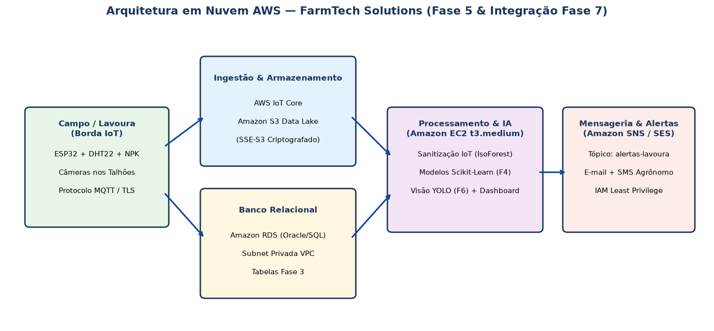
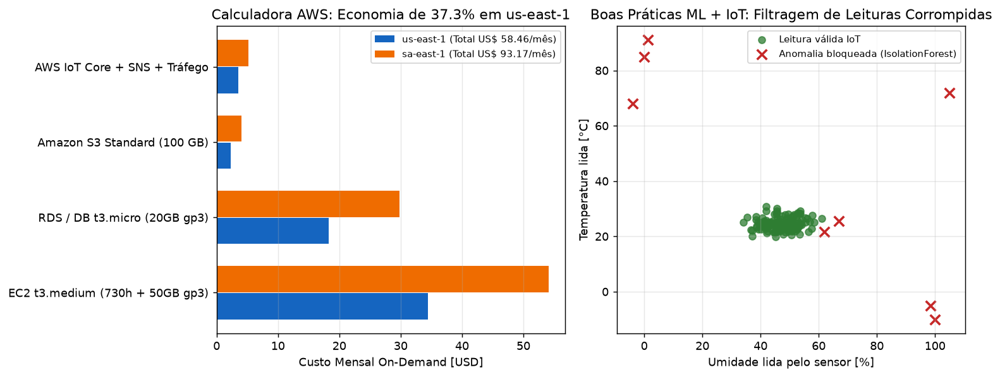

# FIAP - Faculdade de Informática e Administração Paulista

<p align="center">
  <a href="https://www.fiap.com.br/"></a>
</p>

<br>

# 📌 FarmTech Solutions — Fase 5: Tratores Digitais (Infraestrutura AWS, Custos, Segurança & ML com IoT)

[](https://aws.amazon.com/)
[](https://www.python.org/)
[](LICENSE)

## 👨‍🎓 Integrantes
- [Jeliel Cardoso](https://www.linkedin.com/in/jelielcardoso/) — **RM572665**
- [Denis Paulo Dias da Silva](https://www.linkedin.com/in/denispaulodiassilva/) — **RM573278**
- [Deweyne Reuel](https://www.linkedin.com/in/deweyne-reuel-0695522a8/) — **RM573755**

## 👩‍🏫 Professores
### Tutor(a)
- [Sabrina Otoni](https://www.linkedin.com/in/sabrina-otoni-22525519b/)
### Coordenador(a)
- [André Godoi](https://www.linkedin.com/in/andregodoichiovato/)

---

## 📖 Descrição

Na **Fase 5 (Tratores Digitais)** projetamos a infraestrutura em nuvem da **FarmTech Solutions** na **AWS**, comparamos os custos mensais na calculadora oficial entre **N. Virginia (`us-east-1`)** e **São Paulo (`sa-east-1`)**, definimos políticas de segurança **IAM de menor privilégio** (`aws/iam_least_privilege_policy.json` e `aws/cloudformation_farmtech.yaml`) e implementamos a etapa de **sanitização de telemetria IoT** (`IsolationForest`) antes de alimentar os modelos preditivos.

<p align="center">
  
</p>

<p align="center">
  
</p>

---

## 💰 Comparativo de Custos AWS (On-Demand Mensal)

| Serviço AWS | `us-east-1` (N. Virginia) | `sa-east-1` (São Paulo) |
|---|---:|---:|
| EC2 `t3.medium` (2 vCPU, 4 GB RAM, 50 GB gp3) | US$ 34,41 | US$ 54,12 |
| RDS `db.t3.micro` (20 GB gp3) | US$ 18,25 | US$ 29,80 |
| Amazon S3 Standard (100 GB) | US$ 2,30 | US$ 4,05 |
| AWS IoT Core + Amazon SNS | US$ 3,50 | US$ 5,20 |
| **Total Mensal** | **US$ 58,46** | **US$ 93,17** |

- **Decisão por menor custo:** `us-east-1` reduz o custo mensal em **37,3%** (economia de US$ 34,71/mês ou US$ 416,52/ano), pois a telemetria agrícola e os alertas de irrigação toleram latência de ~120–150 ms.
- **Decisão quando houver restrição legal/soberania de dados:** `sa-east-1` mantém os dados em território nacional com latência de ~10–25 ms.

---

## ⚙️ Como Executar

```bash
pip install -r requirements.txt
python -m src.aws_cost_and_ml_iot --demo
pytest -q
```

---

## 📄 Licença

Distribuído sob a licença [MIT](LICENSE).
